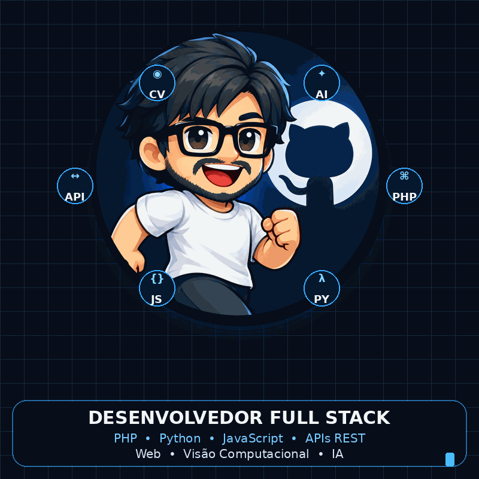

# 👨‍💻 Antonio Mota Junior

### Desenvolvedor Full Stack · PHP · Python · JavaScript

**APIs REST · Web · RPA · Visão Computacional · IA**

📍 Brasília-DF, Brasil

 

---

## 🚀 Sobre mim

Desenvolvedor Full Stack com foco na criação de **sistemas web, APIs, automações e soluções orientadas a dados**, combinando desenvolvimento de software, RPA, visão computacional e Inteligência Artificial.

Tenho interesse em transformar processos reais em aplicações práticas, com foco em **automação, produtividade, análise de dados e integração entre sistemas**.

---

## 🛠️ Stack & Tecnologias

### Linguagens & Backend

### Web & APIs

### 🖥️ Ferramentas Frontend

### Dados, Automação & IA

### Banco de Dados & Ferramentas

---

## 📌 Projetos em destaque

### 🔹 Pipeline RPA Dinâmico & Analítico de Dados
Automação de processos e tratamento de dados, com geração de informações estruturadas para análise e tomada de decisão.

### 🔹 Sistema de Gestão Financeira e Manutenção Patrimonial
Aplicação web para controle financeiro, patrimônio, manutenção e acompanhamento operacional.

### 🔹 Sistema de Gestão de Ordens de Serviço
Sistema voltado ao gerenciamento do fluxo de ordens de serviço, acompanhamento de atividades e organização operacional.

### 🔹 Sistema de Gestão de Turnos e Plantões Familiares
Solução para organização de escalas, turnos e plantões, com foco em praticidade e controle das atividades.

### 🔹 Robô de Automação Baseado em SMC
Automação aplicada a análise e execução de estratégias, utilizando conceitos de Smart Money Concepts (SMC) e integração com MetaTrader 5.

---

## 📂 Outros projetos

- [JARVIS](https://github.com/antoniomotajr/JARVIS)
- [calorias](https://github.com/antoniomotajr/calorias)
- [atlas_stack](https://github.com/antoniomotajr/atlas_stack)
- [Simulador Hídrico e Ambiental — Cultivo de Soja](https://github.com/antoniomotajr/Simulador-H-drico-e-Ambiental---Cultivo-de-Soja)
- [achei](https://github.com/antoniomotajr/achei)
- [mania-manicure](https://github.com/antoniomotajr/mania-manicure)
- [desafio_dev](https://github.com/antoniomotajr/desafio_dev)

---

## 📊 Indicadores no GitHub

> 

  
  

---

## 🎯 Áreas de atuação

- Desenvolvimento Full Stack
- Desenvolvimento de APIs REST
- Sistemas Web
- Automação de processos e RPA
- Integração entre sistemas
- Análise e tratamento de dados
- Visão Computacional
- Inteligência Artificial
- Automação aplicada a operações
- Desenvolvimento de ferramentas internas

---

## 📫 Contato

💼 **LinkedIn:** [linkedin.com/in/afmotajunior](https://www.linkedin.com/in/afmotajunior/)

🌐 **Portfólio:** [jmstudio.orgfree.com/sobre.php](https://jmstudio.orgfree.com/sobre.php)

🎨 **ArtStation:** [artstation.com/afmotajunior](https://www.artstation.com/afmotajunior)

📧 **E-mail:** [antoniomotajr@gmail.com](mailto:antoniomotajr@gmail.com)

---

> **“Transformando processos reais em soluções digitais.”**

  

